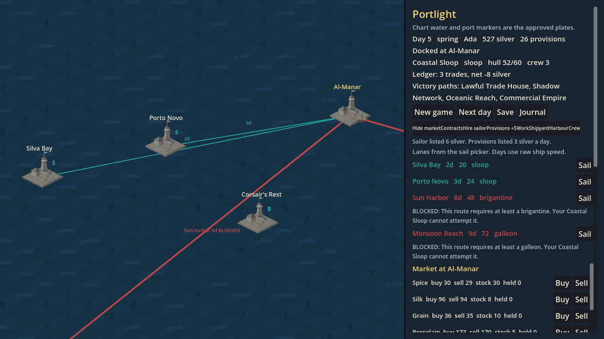
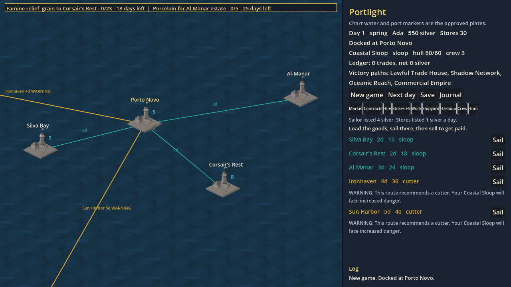

<p align="center">
  <a href="README.md">English</a> | <a href="README.ja.md">日本語</a> | <a href="README.es.md">Español</a> | <a href="README.fr.md">Français</a> | <a href="README.hi.md">हिन्दी</a> | <a href="README.it.md">Italiano</a> | <a href="README.pt-BR.md">Português (BR)</a>
</p>

<p align="center">
  
</p>

<p align="center">
  <a href="https://github.com/mcp-tool-shop-org/portlight-bounty/actions/workflows/ci.yml"></a>
  <a href="https://codecov.io/gh/mcp-tool-shop-org/portlight-bounty"></a>
  <a href="LICENSE"></a>
  <a href="https://mcp-tool-shop-org.github.io/portlight-bounty/"></a>
</p>

Portlight Bounty is a trade game. You buy, you sail, you take a contract, and you try not to arrive broke. The line under the mark is the whole pitch: trade, sail, prosper.

This repository is the Rust port of [Portlight](https://github.com/mcp-tool-shop-org/portlight). The simulation is the rules. The Godot 4.7 chart is the game you play. Version 0.3.2 is the current **source-only developer release** of that pair (pre-built binary exports are planned for a later minor release).

The docked chart, with the market open at Al-Manar:



Two live contracts on the strip. The numbers are cargo delivered, cargo owed, and days left:



## Play (from source)

This release ships as source code only (no pre-built binaries or export presets yet). You need Rust 1.98.1 (the pin in `rust-toolchain.toml`) and Godot 4.7.2, the official build. Linux CI uses that pair. A Windows build of the extension has been run. A macOS build has not. Clone the repository and run Godot's headless asset import once before opening the chart:

```
git clone https://github.com/mcp-tool-shop-org/portlight-bounty.git
cd portlight-bounty
cargo build -p portlight-godot
godot --headless --path godot --import --quit
godot --path godot
```

New game, then The Merchant, and leave the name as Ada if you want the voyage the screenshots show. Sail, trade, and take a contract from the port row. Save writes a version-12 or version-13 slot beside New game (version 13 once a counting-house account is open). A loaded custom captain keeps the name, the silver, and the day. The custom template itself is not in the save, so prices after a load are the merchant's. That matches the Python game.

At sea the port row hides. Next day advances the voyage. The day's report opens over the chart when the day has something to say.

The handbook walks the screens: [landing page](https://mcp-tool-shop-org.github.io/portlight-bounty/), then Handbook.

## The simulation

The crates do not draw. `portlight-sim` is the rules, matching the Python game except the listed Rust-tuned scripts. `portlight-cli` runs a script and prints the snapshot the parity harness compares to Python. `portlight-chart` is the dimetric math, still with no Godot in it.

```
cargo run -p portlight-cli -- new --captain merchant --name Ada --seed 42
cargo run -p portlight-cli -- --help
cargo test --locked --workspace --exclude portlight-godot
```

`portlight --help` lists every script command. Exit codes are 0 when the run worked, 1 when the simulation or a file failed, and 2 when the command was not understood. Failures are sentences. There is no telemetry and no `--debug` switch.

The Python game at commit `9b02494` is the source of the rules. Five captain archetypes carry a small Rust-tuned pricing and burn overlay (`crates/portlight-sim/data/tuned_overlay.json`), and The Bounty Hunter claims +25% on bounties; building with `--features python-base` turns the overlay off so the simulation matches Python unmodified.

## What 0.3.2 is

A playable chart across 20 ports and 43 sea lanes: market, contracts, crew with companion role effects and morale lines, fighting-style masters and skill trainers, an Armoury merchant shop with gear maintenance and blacksmith quality upgrades, the yard, the harbour desk (including counting-house silver accounts at seven ports), hunt and bounties, the journal, combat and contract recap cards, sinking and tow recovery, and sea fights. The world canon (Phases 1-6) lives under `docs/canon/`. The landing bundle is manifest 0.3.0 (`godot/assets/landing/MANIFEST.json`).

## Pictures

The pictures (every image file in the repository) are made by mcp-tool-shop and licensed under CC BY 4.0: anyone may use and adapt them, including commercially, with credit to "mcp-tool-shop". Everything else is MIT. See [LICENSE](LICENSE).

The barrel, bollard, cart, crate, and torch are built by `build_prop()` in [ai-rpg-stage](https://github.com/mcp-tool-shop-org/ai-rpg-stage) (`assets/dimetric/camera/dimetric_60_45.py`) from Blender primitives. That function landed in `55ac9b2`. The manifest called the copy a vendor drop. That meant copied from our own repository, not remade.

The three quay flags were painted on a local ComfyUI setup (a Qwen Image weight and the Salt Road LoRA) and then retoned with a fixed color map.

Version 0.3.2 ships without audio assets (the chart runs silent) and has no ElevenLabs voice.

## Trust

The game is local. It does not open a network connection, it does not have an account, and it does not send telemetry. It reads the catalog baked into the binary, a script you name, and a save you name. It writes a version-12 or version-13 save into a folder you choose. The chart's default folder is `saves/` under the working directory.

Report a vulnerability in private on this repository. See [SECURITY.md](SECURITY.md). There is no separate mailbox.

## Support

0.3.2 is the supported release. Issues and pull requests are welcome. Read [CONTRIBUTING.md](CONTRIBUTING.md) before you send one. The code is MIT and the pictures are CC BY 4.0.

Built by [MCP Tool Shop](https://mcp-tool-shop.github.io/). Code and art: mcp-tool-shop.
